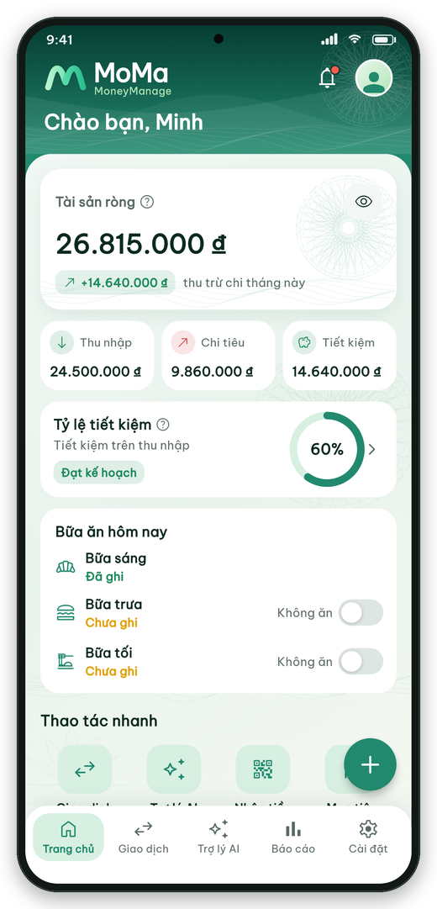
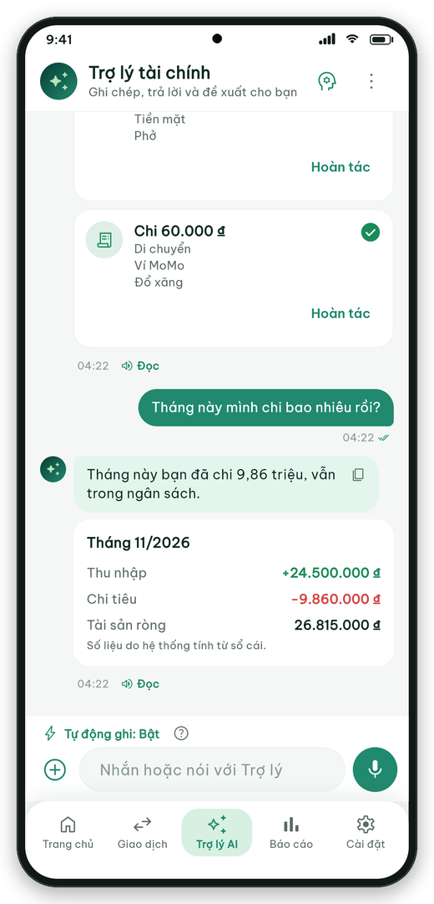
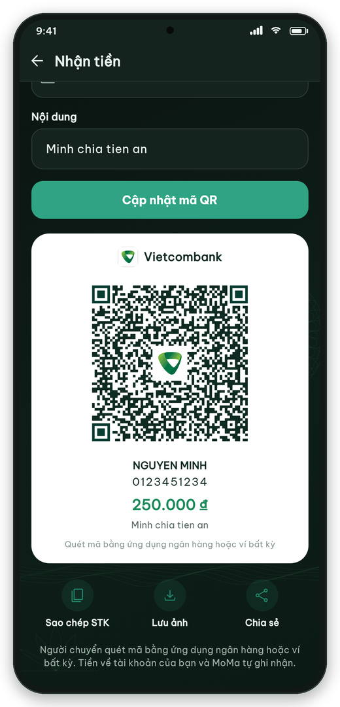
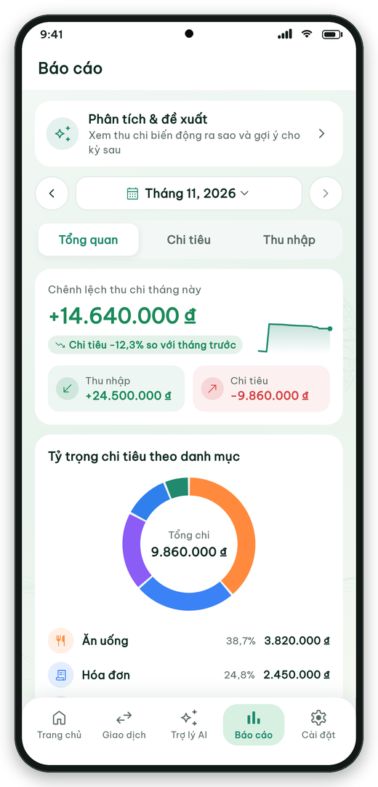
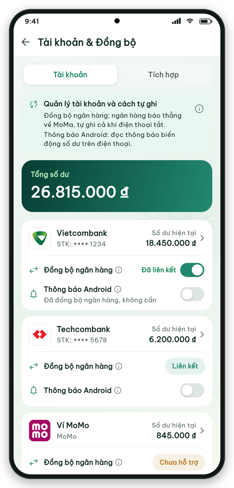
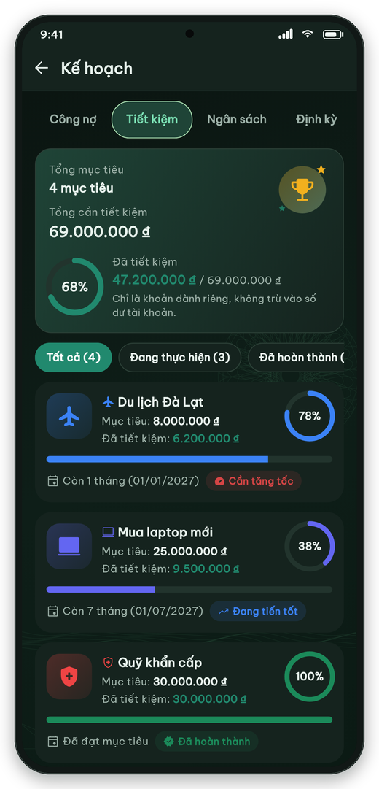
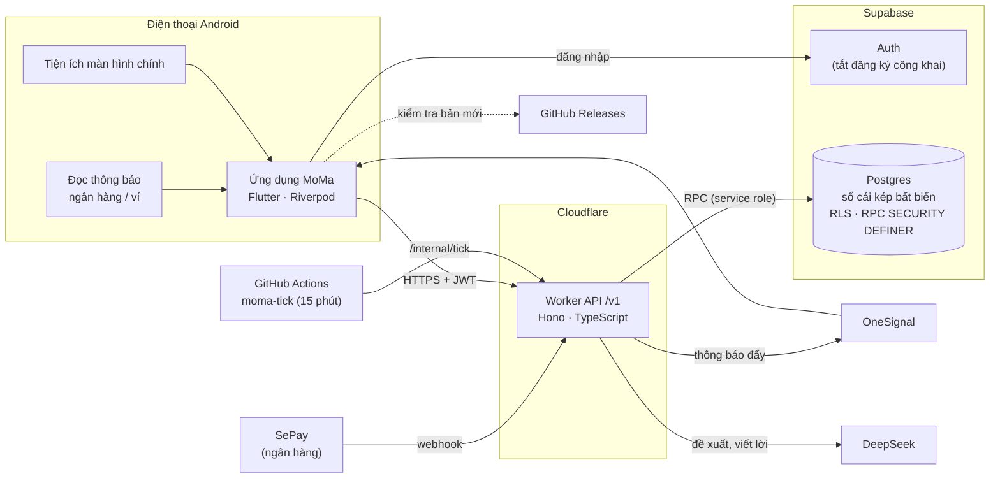

<div align="center">


# MoMa — MoneyManage

**Sổ thu chi tự ghi cho người Việt: ngân hàng, ví điện tử và Trợ lý AI cùng làm sổ giúp bạn.**

MoMa là ứng dụng Android quản lý tài chính cá nhân cho một chủ sở hữu. Tiền vào, tiền ra ở ngân hàng được
ghi tự động qua SePay hoặc từ thông báo trên điện thoại; phần còn lại bạn chỉ cần gõ hoặc nói một câu với
Trợ lý. Mọi số liệu nằm trong sổ cái kép bất biến, báo cáo tính từ sổ cái chứ không phải do AI đoán.

[](https://github.com/NhanSamLe/money-manage-app/actions/workflows/ci.yml)
[](https://github.com/NhanSamLe/money-manage-app/releases/latest)


[](LICENSE)

[Website](https://nhansamle.github.io/money-manage-app/) ·
[Tải về](https://github.com/NhanSamLe/money-manage-app/releases/latest) ·
[Kiến trúc](docs/architecture.md) ·
[Changelog](CHANGELOG.md)

<br>





<sub>Ảnh chụp từ giao diện thật với dữ liệu mẫu (người dùng giả "Minh").</sub>

</div>

---

## Mục lục

- [Tính năng](#tính-năng)
- [Bắt đầu](#bắt-đầu)
- [Cách dùng](#cách-dùng)
- [Kiến trúc](#kiến-trúc)
- [Bảo mật và quyền riêng tư](#bảo-mật-và-quyền-riêng-tư)
- [Xử lý sự cố](#xử-lý-sự-cố)
- [Phát triển](#phát-triển)
- [Ghi nhận](#ghi-nhận)
- [Giấy phép](#giấy-phép)

## Tính năng

| | Tính năng | Mô tả |
|---|---|---|
| 🏦 | **Tự ghi giao dịch từ ngân hàng** | Liên kết tài khoản đã xác minh trên SePay. Ngân hàng báo từng khoản tiền vào, tiền ra về máy chủ MoMa qua webhook, kể cả khi điện thoại tắt. |
| 🔔 | **Đọc thông báo ngân hàng, ví trên máy** | Với ví và ngân hàng chưa liên kết: MoMa đọc thông báo biến động số dư của Vietcombank, Techcombank, MB Bank, TPBank, BIDV, VietinBank, ACB, MoMo, ZaloPay, ShopeePay… ngay trên điện thoại; tin không phải biến động số dư được bỏ qua. |
| 🔁 | **Ghép chuyển khoản nội bộ** | Tiền ra ở tài khoản này và tiền vào ở tài khoản kia của chính bạn được ghép thành một giao dịch chuyển khoản, không tính thành chi tiêu và thu nhập. Trường hợp chưa chắc chắn chỉ được đề xuất để bạn chọn. |
| ✨ | **Trợ lý tài chính AI** | Gõ hoặc nói "ăn phở 45k, đổ xăng 60k bằng MoMo" là có hai khoản chi. Chụp hóa đơn hoặc ảnh chuyển khoản, chữ được đọc trên máy. Trợ lý ghi nhớ thói quen của bạn, trả lời số dư, ngân sách, công nợ. Mọi bước ghi đều hoàn tác được. |
| 📷 | **Nhận tiền bằng VietQR** | Mã QR có logo ngân hàng ở giữa, kèm số tiền và nội dung. Sao chép số tài khoản, lưu hoặc chia sẻ ảnh mã QR. Tiền về được ghi tự động. |
| 📊 | **Báo cáo và phân tích** | Thu chi theo danh mục, theo ngày và tuần, so với tháng trước. Phân tích ngày, tuần, tháng kèm mức chi đề xuất tính từ chính lịch sử của bạn. |
| 🎯 | **Ngân sách, mục tiêu, công nợ, định kỳ** | Ngân sách theo danh mục (chuyển phần dư sang tháng sau), mục tiêu tiết kiệm với vòng tiến độ, cho vay và đi vay có hạn trả, khoản thu chi định kỳ. |
| ⏰ | **Nhắc nhở thông minh** | Nhắc ghi bữa ăn chưa ghi, kiểm tra tiền mặt cuối ngày, tổng kết tuần và tháng, cảnh báo sắp vượt ngân sách. Thông báo đẩy cho mỗi khoản tiền vào, tiền ra. |
| 📱 | **Tiện ích màn hình chính** | Bốn tiện ích: thao tác nhanh, chi tiêu hôm nay, QR nhận tiền, hỏi nhanh Trợ lý. Ghi chi, ghi thu ngay trên màn hình chính mà không cần mở app. |
| 🔒 | **Khóa ứng dụng** | Mã PIN 6 số và vân tay hoặc khuôn mặt, tự khóa sau thời gian ở nền bạn chọn. |
| 📤 | **Xuất dữ liệu** | Excel (.xlsx, nhiều trang) hoặc CSV. Nhập sao kê CSV từ ngân hàng. |
| ⬆️ | **Tự cập nhật trong app** | App tự kiểm tra bản mới trên GitHub Releases, tải và mở trình cài đặt. |
| 🌗 | **Giao diện sáng và tối** | Sáng, tối hoặc theo hệ thống. Hoạt động offline: giao dịch ghi khi mất mạng được xếp hàng và gửi lại, không ghi trùng. |

<p align="center">



</p>

## Bắt đầu

> MoMa phục vụ **một chủ sở hữu**. Bản APK trên Releases kết nối tới máy chủ của chủ sở hữu và chỉ email chủ sở hữu
> đăng ký được. Muốn có MoMa của riêng bạn, xem [Phát triển](#phát-triển) và [`docs/DEPLOYMENT.md`](docs/DEPLOYMENT.md).

1. **Tải APK** mới nhất ở [GitHub Releases](https://github.com/NhanSamLe/money-manage-app/releases/latest) (tệp `MoMa-<phiên bản>.apk`).
2. **Cài đặt**: mở tệp vừa tải, cho phép "Cài ứng dụng không rõ nguồn gốc" nếu Android hỏi. Cần Android 7.0 trở lên.
3. **Tạo tài khoản lần đầu**: chọn "Tạo tài khoản mới", nhập email chủ sở hữu, tên và mật khẩu. Máy chủ gửi mã xác nhận
   tới email đó; nhập mã là xong. Những lần sau đăng nhập bằng email và mật khẩu (quên mật khẩu thì đặt lại bằng mã qua email).
4. **Thiết lập có hướng dẫn** (7 bước, đều bỏ qua được trừ tài khoản đầu tiên): hồ sơ, tiền mặt đang có, tài khoản ngân hàng
   và ví, kiểm tra số dư, nguồn dữ liệu tự ghi, tùy chọn, hoàn tất.

Bản cập nhật sau đó được app tự đề nghị cài; có thể kiểm tra thủ công ở **Cài đặt → Kiểm tra cập nhật**.

## Cách dùng

### Liên kết ngân hàng qua SePay

1. Trên [my.sepay.vn](https://my.sepay.vn), thêm tài khoản ngân hàng của bạn và xác minh bằng OTP của ngân hàng.
2. Trong MoMa: **Tài khoản & Đồng bộ → Tích hợp → Đồng bộ ngân hàng (SePay)**, bấm **Làm mới**, chọn tài khoản để kết nối
   (gắn vào tài khoản MoMa có sẵn hoặc tạo mới).
3. MoMa lấy số dư hiện tại và từ đó tự ghi mọi khoản tiền vào, tiền ra. Tài khoản đã liên kết sẽ không đọc thông báo
   trên máy nữa để tránh ghi trùng.

Phía máy chủ cần `SEPAY_API_TOKEN` và webhook SePay trỏ về `/v1/webhooks/sepay` (xác thực bằng API key hoặc HMAC) — xem
[`docs/DEPLOYMENT.md`](docs/DEPLOYMENT.md).

### Thông báo ngân hàng trên máy

Dùng cho ví điện tử, thẻ và ngân hàng chưa liên kết SePay.

1. **Tài khoản & Đồng bộ**, ở thẻ tài khoản, bật **Thông báo Android** và cấp quyền "Truy cập thông báo" cho MoMa.
2. Chọn ứng dụng ngân hàng hoặc ví tương ứng (MoMa gợi ý các app đã cài).
3. Từ đó mỗi thông báo biến động số dư được đọc trên máy và ghi thành giao dịch, kể cả khi không mở MoMa.
   Thông báo được phân tích ngay trên điện thoại; máy chủ chỉ nhận giao dịch đã tách ra (số tiền, thời điểm, nội dung
   chuyển khoản làm ghi chú); số dư trong thông báo dùng để đối chiếu với số dư trên MoMa.

MoMa không xin quyền SMS hay Trợ năng (Accessibility).

### Trợ lý tài chính

- Gõ (hoặc bấm micro để nói) một câu tự nhiên: *"lương về 24 triệu"*, *"cho Lan mượn 2 triệu, hẹn cuối tháng trả"*,
  *"dành 500k cho mục tiêu Đà Lạt"*, *"tháng này mình chi bao nhiêu rồi?"*.
- Bấm **+** để chụp hoặc chọn ảnh hóa đơn, ảnh chuyển khoản. Chữ được nhận dạng ngay trên máy, chỉ phần chữ được gửi đi.
- **Tự động ghi: Bật** cho phép Trợ lý ghi ngay các bước rủi ro thấp (thu, chi, chuyển khoản), mỗi bước có nút **Hoàn tác**.
  Việc quan trọng hơn (công nợ, ngân sách, tài khoản mới, hủy giao dịch) luôn chờ bạn bấm **Xác nhận**.
- Trợ lý chỉ đề xuất; máy chủ kiểm tra lại từng số tiền, tài khoản, ngày rồi ghi bằng đúng các lệnh như khi bạn nhập tay.
- Xem và xóa những gì Trợ lý đã ghi nhớ ở biểu tượng bộ nhớ góc trên.

### Tiện ích

Nhấn giữ màn hình chính → **Tiện ích** → **MoMa**, hoặc vào **Cài đặt → Tiện ích màn hình chính** để thêm:

| Tiện ích | Nội dung | Kích thước |
|---|---|---|
| Thao tác nhanh | Ghi chi, ghi thu, QR, Trợ lý AI | 2×1 đến 4×2 |
| Chi tiêu hôm nay | Hôm nay, tháng này, ngân sách | 2×1 đến 4×2 |
| QR nhận tiền | Mã VietQR của tài khoản đã liên kết | 2×1 đến 4×2 |
| Trợ lý tài chính | Thanh hỏi nhanh Trợ lý | 2×1 đến 4×1 |

Bấm **Ghi chi** hoặc **Ghi thu** trên tiện ích sẽ mở khung ghi nhanh ngay trên màn hình chính.

### Nhắc nhở

**Cài đặt → Nhắc nhở & thông báo**: chọn giờ nhắc cho bữa sáng, trưa, tối (chỉ nhắc khi bữa đó chưa được ghi), kiểm tra
tiền mặt cuối ngày, tổng kết tuần (chọn thứ), tổng kết tháng và cảnh báo sắp vượt ngân sách. Nhắc được tính trên máy chủ
mỗi 15 phút và gửi qua thông báo đẩy; chuông trong app giữ lại các thông báo đã gửi.

## Kiến trúc



- **Sổ cái là nguồn sự thật.** Mỗi giao dịch là một bút toán kép cân bằng bằng 0, chỉ được ghi qua RPC nguyên tử trong
  Postgres. Bút toán đã ghi không sửa, không xóa: sửa sai bằng đảo bút toán rồi ghi lại, lịch sử luôn còn.
- **Lệnh idempotent.** App gửi lệnh (`TX_CREATE`, `DEBT_CREATE`, …) kèm `command_id`; gửi lại cùng lệnh trả về kết quả cũ, nên
  hàng đợi offline và mạng chập chờn không gây ghi trùng.
- **Tiền là số nguyên VND** (`bigint` trong SQL, chuỗi số trên JSON). Báo cáo cắt theo múi giờ `Asia/Ho_Chi_Minh`.
- **AI không ghi sổ.** DeepSeek chỉ trả về kế hoạch; Worker kiểm tra id, số tiền, ngày rồi chuyển thành lệnh thường.
  Số liệu phân tích do SQL và TypeScript tính, AI chỉ viết lời.
- **Lịch chạy định kỳ**: cron của Worker và dự phòng GitHub Actions gọi `/v1/internal/tick`; mỗi thông báo được "claim"
  một lần nên gọi trùng vô hại.

Chi tiết: [`docs/architecture.md`](docs/architecture.md) · ADR: [`docs/adr/`](docs/adr) · Nhật ký quyết định:
[`docs/decision-log.md`](docs/decision-log.md) · Đặc tả: [`spec/`](spec/README.md).

## Bảo mật và quyền riêng tư

- **Một chủ sở hữu.** Đăng ký công khai của Supabase luôn tắt; chỉ email chủ sở hữu (secret `OWNER_EMAIL`) kích hoạt được,
  bằng mã gửi qua email. Mọi yêu cầu API được kiểm tra JWT (issuer, audience, hạn) và gắn với đúng chủ sở hữu và thiết bị.
- **RLS và RPC chỉ dành cho service role.** Bảng bật Row Level Security; ghi dữ liệu chỉ qua hàm `SECURITY DEFINER` mà
  vai trò công khai không gọi được.
- **Bí mật chỉ nằm trong Worker secrets** (`SUPABASE_SERVICE_ROLE_KEY`, `DEEPSEEK_API_KEY`, `SEPAY_*`, `ONESIGNAL_REST_KEY`,
  `CRON_SECRET`). App chỉ có publishable key; khóa ký APK không bao giờ vào repo. CI quét bí mật bằng gitleaks.
- **PIN băm bằng PBKDF2-HMAC-SHA256** (120.000 vòng, muối ngẫu nhiên) và lưu trong Android Keystore; phiên đăng nhập cũng vậy.
- **Dữ liệu ở Supabase của chủ sở hữu.** Không có máy chủ trung gian nào khác lưu dữ liệu tài chính.
- **AI chỉ nhận phần cần thiết**: câu bạn gõ hoặc chữ đọc từ ảnh, tên tài khoản, danh mục, mục tiêu, người liên hệ và
  ghi nhớ của Trợ lý. Không gửi số tài khoản, số dư hay ảnh gốc. Không có khóa AI thì Trợ lý tắt, phần còn lại vẫn chạy.
- **Không quảng cáo, không theo dõi.** Không SDK phân tích hay quảng cáo; OneSignal chỉ dùng để gửi thông báo đẩy.
- Nhật ký máy chủ chỉ có `request_id`, đường dẫn và mã lỗi, không có nội dung thông báo, OTP hay mật khẩu.

Báo lỗ hổng: xem [`SECURITY.md`](SECURITY.md).

## Xử lý sự cố

| Triệu chứng | Nguyên nhân thường gặp | Cách xử lý |
|---|---|---|
| Android chặn cài APK | Chưa cho phép cài từ nguồn này | Cho phép "Cài ứng dụng không rõ nguồn gốc" cho trình duyệt hoặc trình quản lý tệp |
| "Ứng dụng chưa được cài đặt" khi cập nhật | APK ký bằng khóa khác bản đang cài | Gỡ bản cũ (xuất dữ liệu trước) rồi cài lại |
| Không đăng ký được | Email không phải email chủ sở hữu | Dùng đúng email đã đặt trong `OWNER_EMAIL` |
| Không thấy giao dịch từ thông báo | Chưa cấp quyền truy cập thông báo, hoặc máy tắt app chạy nền | Bật lại ở **Tài khoản & Đồng bộ**; tắt tối ưu pin cho MoMa |
| Tài khoản SePay không hiện | Chưa xác minh trên SePay hoặc chưa làm mới | Xác minh trên my.sepay.vn rồi bấm **Làm mới** |
| Trợ lý báo không khả dụng | Máy chủ chưa đặt `DEEPSEEK_API_KEY` | Đặt secret cho Worker; phần ghi tay vẫn dùng được |
| Không nhận thông báo đẩy | Chưa cho phép thông báo hoặc thiếu khóa OneSignal | Cho phép thông báo trong cài đặt Android; kiểm tra `ONESIGNAL_REST_KEY` |
| Banner "giao dịch chờ đồng bộ" | Đang offline | Có mạng lại sẽ tự gửi; bấm **Xem** để gửi ngay hoặc bỏ lệnh lỗi |
| "Kiểm tra cập nhật" báo lỗi | Giới hạn 60 lần/giờ của API GitHub | Thử lại sau |

Sự cố phía máy chủ (secret, tên miền, `OWNER_NOT_BOUND`…): [`docs/DEPLOYMENT.md`](docs/DEPLOYMENT.md#4-xử-lý-sự-cố-thường-gặp).

## Phát triển

**Yêu cầu**: Node 22+, Flutter (stable, Dart 3.14+), JDK 21, Android SDK 36, Docker (Postgres 17 cho kiểm thử SQL và e2e),
Python 3.11+.

```bash
# API (Cloudflare Worker)
cd apps/api && npm ci
npm run typecheck && npm test          # unit test (Vitest)
npm run test:e2e                       # end-to-end: Postgres + PostgREST thật
npm run dev                            # wrangler dev

# Ứng dụng Android
cd apps/android && flutter pub get
dart format lib test && flutter analyze --fatal-infos && flutter test
flutter build apk --debug

# Cơ sở dữ liệu: áp mọi migration vào DB trống rồi chạy kiểm thử bất biến sổ cái
docker run -d --name moma-pg -e POSTGRES_PASSWORD=local -p 54329:5432 postgres:17
PGHOST=localhost PGPORT=54329 PGUSER=postgres PGPASSWORD=local bash scripts/db-test.sh

# Phiên bản đồng bộ giữa VERSION, API và app
node scripts/check-versions.mjs

# Ảnh chụp màn hình cho README và website (dữ liệu mẫu)
cd apps/android && MOMA_SCREENSHOTS=1 flutter test test/screenshots && python test/screenshots/frame.py
```

**Phát hành**: `scripts/release.ps1 minor|patch` (hoặc `scripts/release.sh`) kiểm tra, tăng phiên bản, build APK đã ký và tạo
GitHub Release — xem [`docs/RELEASE.md`](docs/RELEASE.md) và [`docs/RELEASING.md`](docs/RELEASING.md).
Triển khai máy chủ: [`docs/DEPLOYMENT.md`](docs/DEPLOYMENT.md). Quy ước code: [`CONTRIBUTING.md`](CONTRIBUTING.md), [`AGENTS.md`](AGENTS.md).

```
moma/
├── apps/
│   ├── android/          # Ứng dụng Flutter (lib/app, lib/core, lib/features/*), widget Kotlin
│   └── api/              # Cloudflare Worker: entrypoints/ (route), modules/ (ai, bank, ledger, push, …)
├── supabase/
│   ├── migrations/       # SQL theo thứ tự, chỉ thêm mới
│   ├── tests/            # kiểm thử bất biến sổ cái và RPC
│   └── templates/        # mẫu email mã xác nhận
├── e2e/                  # Postgres + PostgREST cho kiểm thử end-to-end
├── spec/                 # đặc tả v1.0, hợp đồng OpenAPI / JSON Schema
├── design/               # thiết kế UI, thương hiệu
├── docs/                 # kiến trúc, triển khai, phát hành, ADR, ảnh
├── website/              # trang giới thiệu (GitHub Pages)
└── scripts/              # phát hành, kiểm tra phiên bản, kiểm thử DB
```

## Ghi nhận

MoMa được xây trên các dự án và dịch vụ:
[Flutter](https://flutter.dev) ·
[Riverpod](https://riverpod.dev) ·
[go_router](https://pub.dev/packages/go_router) ·
[supabase_flutter](https://pub.dev/packages/supabase_flutter) ·
[qr_flutter](https://pub.dev/packages/qr_flutter) ·
[Google ML Kit Text Recognition](https://pub.dev/packages/google_mlkit_text_recognition) ·
[speech_to_text](https://pub.dev/packages/speech_to_text) ·
[local_auth](https://pub.dev/packages/local_auth) ·
[excel](https://pub.dev/packages/excel) ·
[Material Symbols](https://pub.dev/packages/material_symbols_icons) ·
[Be Vietnam Pro](https://fonts.google.com/specimen/Be+Vietnam+Pro) ·
[Hono](https://hono.dev) ·
[Zod](https://zod.dev) ·
[jose](https://github.com/panva/jose) ·
[Cloudflare Workers](https://workers.cloudflare.com) ·
[Supabase](https://supabase.com) ·
[SePay](https://sepay.vn) ·
[OneSignal](https://onesignal.com) ·
[DeepSeek](https://www.deepseek.com) ·
[VietQR](https://vietqr.net).
Logo ngân hàng và ví thuộc về chủ sở hữu tương ứng. Giấy phép của các thư viện: [`docs/THIRD_PARTY.md`](docs/THIRD_PARTY.md),
hoặc trong app tại **Cài đặt → Giới thiệu → Giấy phép**.

## Giấy phép

© 2026 Lê Đào Nhân Sâm. Bảo lưu mọi quyền.

Mã nguồn được công khai để tham khảo; không được sao chép, phân phối hay tạo sản phẩm phái sinh khi chưa có sự đồng ý
bằng văn bản của tác giả. Xem [`LICENSE`](LICENSE).
