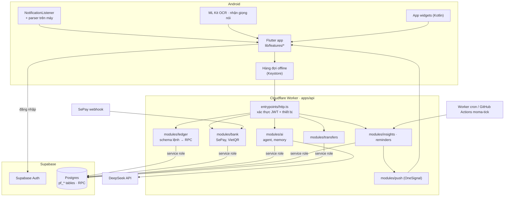

# Kiến trúc MoMa

Tài liệu tổng quan cho người đọc mã. Quy tắc bắt buộc nằm ở [`AGENTS.md`](../AGENTS.md) và
[`spec/docs/11-engineering-standards.md`](../spec/docs/11-engineering-standards.md); lý do của từng lựa chọn ở
[`docs/adr/`](adr) và [`docs/decision-log.md`](decision-log.md). Mã thắng nếu tài liệu này lệch.

## 1. Thành phần

| Lớp | Công nghệ | Thư mục |
|---|---|---|
| Ứng dụng | Flutter, Riverpod, go_router, Material 3 | `apps/android/lib` (`app/` theme + router, `core/` mạng, tiền, model, `features/` theo màn hình) |
| Tiện ích, đọc thông báo | Kotlin (AppWidgetProvider, NotificationListenerService) | `apps/android/android/app/src/main/kotlin/vn/moma/app` |
| API | Cloudflare Worker, Hono, Zod, jose | `apps/api/src` (`entrypoints/` route, `modules/` nghiệp vụ, `shared/`) |
| Dữ liệu | Supabase Postgres + Auth | `supabase/migrations` (chỉ thêm mới), `supabase/tests` |
| Hợp đồng | OpenAPI, JSON Schema lệnh | `spec/contracts` |

## 2. Sổ cái

- Mỗi giao dịch (`pf_tx`) có một bút toán (`pf_journal`) gồm các dòng (`pf_entry`) cộng lại bằng 0. Tài khoản người dùng
  (`pf_account`) trỏ tới tài khoản sổ cái (`pf_ledger_account`); có các tài khoản hệ thống như số dư đầu kỳ, phí
  chuyển khoản, điều chỉnh, tiền chưa phân loại.
- Chỉ RPC `SECURITY DEFINER` trong migration được ghi. Bút toán đã ghi bất biến; hủy hoặc sửa tạo bút toán đảo và bút toán mới
  liên kết (`related_tx_id`).
- Khoản chưa rõ loại (`UNKNOWN_CREDIT`/`UNKNOWN_DEBIT`) vào tài khoản treo và không tính vào thu chi đã phân loại.
- Tiền là `bigint` VND trong SQL, chuỗi số trên JSON, `int` trong Dart. Báo cáo cắt theo `Asia/Ho_Chi_Minh`, khoảng `[từ, đến)`.

## 3. Luồng ghi

1. App tạo lệnh (`TX_CREATE`, `DEBT_REPAY`, `GOAL_ALLOCATE`, …) với `command_id` cố định và gửi `POST /v1/commands`.
2. Worker kiểm tra phiên (JWT Supabase, chủ sở hữu, thiết bị) và schema lệnh, rồi gọi `pf_execute_command`.
3. RPC kiểm tra `expected_version`, ghi bút toán, lưu kết quả theo `command_id` + hash. Gửi lại cùng lệnh trả kết quả cũ
   (`REPLAYED`), khác nội dung với cùng id bị từ chối.
4. Mất mạng: lệnh nằm trong hàng đợi offline, gửi lại đúng thứ tự, lệnh bị từ chối giữ lại tới khi chủ sở hữu bỏ.

## 4. Nguồn dữ liệu tự động

| Nguồn | Đường đi | Ghi chú |
|---|---|---|
| SePay | Webhook `POST /v1/webhooks/sepay` (API key hoặc HMAC) → sự kiện nguồn → giao dịch | Hoạt động cả khi điện thoại tắt; tài khoản phải được ngân hàng xác minh trên SePay |
| Thông báo Android | NotificationListener → parser trên máy → `TX_CREATE` nguồn `NOTIFICATION` | Ánh xạ từng app ngân hàng/ví với một tài khoản; tài khoản đã liên kết SePay bị bỏ qua để không trùng |
| Trợ lý AI | `POST /v1/ai/agent` → kế hoạch đã kiểm tra → app chạy lệnh thường | Bước rủi ro thấp có thể tự chạy (hoàn tác được), bước khác chờ xác nhận |
| Nhập tay, CSV | Form, câu tiếng Việt, sao kê CSV → `TX_CREATE` | CSV dùng `command_id` tất định theo tệp + dòng nên nhập lại không trùng |

Sau mỗi giao dịch từ ngân hàng hoặc thông báo, module chuyển khoản tìm chiều còn lại ở tài khoản khác của chủ sở hữu
và ghép thành một `TRANSFER` (tự động khi chắc chắn, đề xuất khi chưa chắc; quy tắc ở D-018).

## 5. Tác vụ định kỳ

Cron Worker mỗi 15 phút, dự phòng bằng workflow `moma-tick.yml` gọi `POST /v1/internal/tick` (header `x-cron-secret`).
Một lượt tick: nhắc bữa ăn, kiểm tra tiền mặt, tổng kết ngày/tuần/tháng, cảnh báo ngân sách, đối soát chuyển khoản 48 giờ.
Mỗi thông báo đẩy được "claim" một lần trong `pf_push_log` nên gọi trùng không gửi hai lần. Thông báo cũng được lưu vào
hộp thư trong app.

## 6. AI

- Mô hình: DeepSeek qua Worker; khóa chỉ là Worker secret. Không có khóa thì mọi tính năng AI tắt, app vẫn đầy đủ.
- Đầu vào: câu của chủ sở hữu (hoặc chữ OCR từ ảnh, đọc trên máy), id và tên tài khoản, danh mục, người liên hệ, mục tiêu,
  công nợ đang mở, vài lượt hội thoại gần nhất và ghi nhớ đã lưu. Không gửi số tài khoản, số dư hay ảnh.
- Đầu ra là kế hoạch JSON; `resolveAgentOutput` đối chiếu từng bước với dữ liệu thật và schema lệnh, bước không an toàn
  thành câu hỏi lại. Chi phí từng lần gọi được ghi vào `pf_ai_usage`.
- Phân tích và đề xuất mức chi: số liệu do SQL/TypeScript tính (trung vị các kỳ gần nhất), AI chỉ viết lời.

## 7. Ranh giới bảo mật

| Ranh giới | Biện pháp |
|---|---|
| App ↔ API | HTTPS, JWT Supabase (JWKS; HS256 chỉ khi đặt secret), `X-Device-Id` đã đăng ký, chủ sở hữu duy nhất |
| API ↔ DB | Service role chỉ ở Worker; RLS bật; RPC không cấp cho `anon`/`authenticated` |
| Webhook | SePay API key hoặc chữ ký HMAC, so sánh thời gian hằng |
| Cron | `x-cron-secret` |
| Thiết bị | Phiên, hàng đợi, cài đặt khóa trong Android Keystore; PIN PBKDF2-SHA256 120.000 vòng; `allowBackup=false` |
| Nhật ký | Chỉ `request_id`, đường dẫn, mã lỗi |

## 8. Phát hành

APK ký bằng khóa riêng, phát hành qua GitHub Releases bằng `scripts/release.ps1`/`release.sh`; app đọc `releases/latest`
để tự cập nhật. Chi tiết: [`RELEASE.md`](RELEASE.md), [`RELEASING.md`](RELEASING.md).
