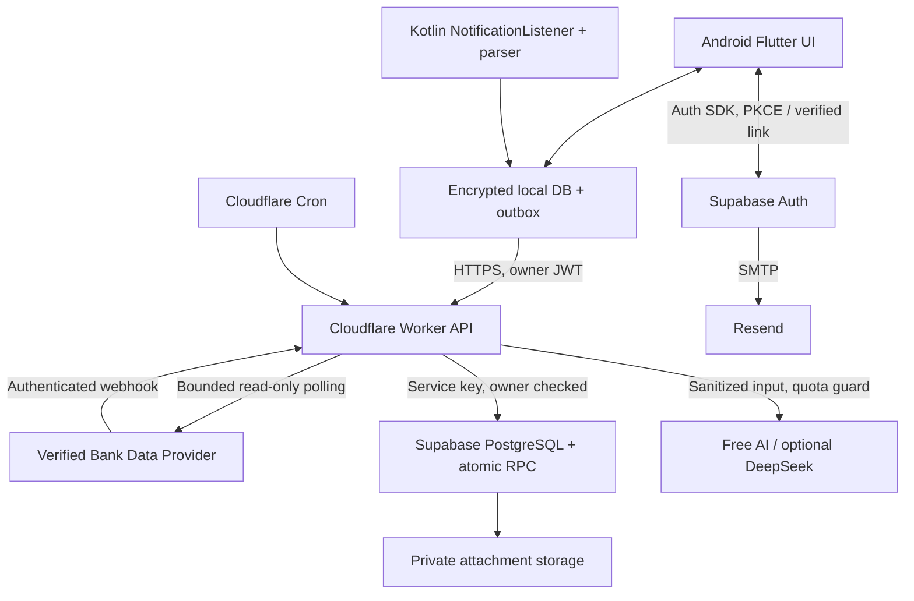

# 06 — HLD, security and offline architecture

## 1. Target architecture

This is a serverless modular monolith. Worker handles I/O and orchestration, not expensive CPU. PostgreSQL runs aggregate queries and transactional mutations. No VPS, Docker daemon, Redis, Kafka or always-running agent. Mobile works when cloud temporarily unavailable. Domain `api.<your-domain>` Worker Custom Domain; `auth.<your-domain>` optional Worker static recovery route, not Supabase paid custom domain. Use API base fixed to same configured verified HTTPS domain; Auth issuer from server deployment config, app only trusts returned project from owner-controlled domain. All monetary mutation APIs v1 routed through Worker, no direct table writes from app. Supabase Auth SDK direct login/recovery/invite session; project URL and publishable/anon key may be public, service-role key never. Access token JWT verified via supported JWKS or Supabase auth getUser (verify issuer, audience, expiry, user ID); legacy symmetric token verification never expose secret; fail closed when verification unavailable. Owner row bound to verified auth user UUID; all owner routes check active singleton even with valid JWT. Explicit owner check before service role use. JWT refresh handled SDK. Use short TTL (e.g. 10–15min if configured supported) and server session epoch/revocation check; revoking refresh alone does not immediately invalidate existing JWT. For device revocation require active device ID + owner JWT for device APIs; bind device ID to session via server record, not client ID alone. No public registration.

## 2. Component boundaries
| Module | Responsibility | Excludes |
|---|---|---|
| auth/setup | owner provisioning, invite, auth policy, session/device checks | banking login |
| accounts | financial account identity, baseline, snapshots, source settings | calculated ledger writes |
| ledger | transactions/journals/entries, correction, command receipts | AI calls |
| integration | webhook, polling, capabilities, parse validation, event inbox, matching | payment initiation |
| debt | obligation and repayments via ledger commands | external debt collection |
| planning | budgets, savings, recurring expected items | actual booking without event |
| reporting | SQL read models and period definitions | AI arithmetic |
| ai | providers, redaction, proposals, approved read queries, usage guard | unrestricted SQL/actions |
| jobs/ops | lease, retries, reminders, export, backup, monitoring | always-on server |

## 3. Suggested repository layout
```
/apps/android/                 Flutter + Kotlin listener module
  lib/features/{auth,setup,home,transactions,accounts,debt,planning,ai,settings}
  lib/core/{network,storage,models,theme,formatting}
  android/app/src/main/kotlin/.../{collector,parser,outbox,security}
/apps/api/                     TypeScript Worker (Hono or lightweight router)
  src/modules/{auth,account,ledger,integrations,debts,planning,reports,ai,ops}
  src/adapters/{sepay,notification,statement,ai,email}
  src/lib/{auth,errors,validation,redaction,idempotency,config}
/supabase/migrations/          ordered SQL; integration tests
/packages/contracts/         generated TS/Dart types, OpenAPI, JSON Schema
/tests/{fixtures,contract,db,e2e,security}
```
Pick maintained stable versions at implementation, pin lockfiles, CI build signed Android release manually. Hono optional but avoid NestJS/Node server APIs unsupported in Workers. Use fetch-based Supabase client/PostgREST RPC; no direct long-lived TCP connection. Heavy image OCR local (ML Kit or supported on-device library; verify license, language and model download requirements), import parse on device, chunk upload. Don't depend on a local model server. Android voice input via device speech service if available; disclose cloud processing, typing fallback. Optional notifications: local scheduled reminders using WorkManager (approximate); FCM only if validated free config, use server secrets and no financial amounts on lock screen. No mandatory Firebase paid plan.

## 4. Key sequences
### Source intake
Provider → Worker verifies signature/key and mapping → atomic `receive_event` stores inbox event + job → ACK → bounded cron/inline processing → deterministic match → `post_financial_command` atomic journal or review → change feed → app refresh. If API and notification arrive together use DB unique keys and locking; retry deterministic. Android offline event queue sends same delivery ID until ACK; never trust client balance or classification as verified bank facts.
### Manual transaction
User quick text → local parse / Worker AI proposal if enabled → preview → command with idempotency key + expected version → atomic validation and posting → result + change cursor → update local cache. Offline local pending command uses same ID; if app restarts, queue persists; rejected commands show actionable reason and no false booked total.
### Recovery
Auth SDK sends recovery email via Resend SMTP; HTTPS verified app link, SDK token exchange per actual Supabase flow; no sensitive query in logs/analytics; set new password via authenticated recovery session; revoke refresh sessions, advance server session policy where possible; force login. If email lost, operator recovery via Supabase dashboard with verified ownership; no app bypass/master password. No public account email enumeration.

## 5. Offline sync and concurrency
Separate native event outbox and Flutter command/cache DB, each using SQLite with SQLCipher-compatible encryption if available, key generated and wrapped in Android Keystore; otherwise encrypt sensitive columns with authenticated encryption and document limitations, avoid plaintext backups. Android Auto Backup exclude tokens/DB/outbox or explicitly encrypted portable export. Use separate local owner/instance namespace; cache read models, account settings, rules and transaction summaries, not cloud keys. Local tables: `cached_entities`, `outbox_commands`, `outbox_events`, `sync_cursor`, `device_config`, `pending_proposals`. Commands carry client UUID, schema version, created_at, expected entity version; states QUEUED/SENDING/ACKED/CONFLICT/FAILED. Exponential backoff 5s→15min jitter, batch <=25, network constraint. Server change feed monotonically increasing bigint sequence with owner filter, keyset cursor; pull 100 records max, tombstones for archived nonledger entities; atomic local apply then advance cursor. Full refresh snapshot if cursor outside retention. Never apply optimistic balance as posted: show projected pending separately. If multiple devices edit, server expected version conflict with current snapshot; no last-write-wins for money. Clock skew handled by server arrival timestamp, device time only evidence. Config source version/epoch synced on resume and collector periodic check; offline revocation only takes effect locally when known, server rejects revoked uploads. Incomplete events quarantined not silently posted.

## 6. Security requirements / threat model
| Threat | Mitigation | Test |
|---|---|---|
| Unauthorized setup takeover | deployment secret random ≥32 bytes, fixed owner email, invite verifies email, single-row provisioning lock + idempotent retry, secret rotated/disabled; no public signUp | SEC-01 |
| JWT theft/other Supabase users | verify token and owner UUID, device binding/revocation, short expiry, secure store, no tokens in logs | SEC-02/03 |
| Service-role key leak | Worker secret only, separate dev/prod, least privilege where available, RLS deny app clients, rotate after leak | SEC-04 |
| Forged webhook/replay | provider official auth, timestamp/nonce if available, unique external ID, bounded body, TLS, rate limit, no reliance on URL secrecy | SEC-05 |
| Malicious Android app notification | OS package allowlist/signature check when feasible, trusted template, provisional evidence, no arbitrary parser execution | SEC-06 |
| OTP/PII exposure | local exclusion/sanitization before persistent storage/network, no permission bypass, no raw dumps, no cloud AI raw | SEC-07 |
| Prompt injection | delimit data, strict schema, allowlist actions, read-only tools, user approval, no direct DB writes | SEC-08 |
| SSRF | hardcoded official provider base URLs, no redirects to arbitrary hosts, no fetch user URL from worker | SEC-09 |
| Duplicate/race/double spending | DB atomic RPC, idempotency/request hash, row locks, balanced journals, debt remaining constraints | FIN-01/INT-03 |
| Data leak via export/attachment | private bucket, signed short-lived access, encrypt backup, user confirm, no public links | SEC-10 |
| Cost abuse | owner-only AI, rate limit, prepaid/no auto top-up, budget reservation, upstream provider fee gate | COST-01 |
| Cloud failure/deletion | encrypted export regularly, recovery drill, offline queue, no hidden SLA | OPS-01 |

Additional: CORS restrictive for browser recovery pages; mobile is not protected by CORS. Auth endpoints generic response, rate limits per IP and normalized email hash (DB atomic counter, TTL). Android release app network security config no cleartext, no trust-all certificates; TLS public CA, don't pin a single certificate that expires without rotation plan. Secret names in config only. Key rotation/revoke via dashboards; don't store external tokens in local DB. Supabase `pf_*` tables RLS enabled with no anon/authenticated direct policy; grant service_role only. Service role bypasses RLS so server owner validation and RPC authorization are essential. No `SECURITY DEFINER` with unrestricted access; revoke PUBLIC EXECUTE, explicit service_role grant. Restrict backend body size and SQL query bounds; validate all input; SQL parameters not string concatenation. Owner deletion requires recent auth, typed phrase, backup prompt; purge data and revoke sessions, keep deployment bootstrap disabled until operator explicit reset. No provider bank-side destructive action.

## 7. Async jobs
Durable jobs table with type, payload minimal identifiers, state, due_at, lease_until, attempts, dedup_key; `SELECT ... FOR UPDATE SKIP LOCKED` via RPC claim. Worker cron one trigger every 15 min, runs bounded batch (10), per job network timeout/retry, returns before CPU/time quota; second trigger optional daily summary; don't rely on `waitUntil` alone for durability. Jobs: PROCESS_EVENT, POLL_PROVIDER, RECONCILE, REMINDER, PURGE_RAW, AI_CLASSIFY (optional). Retry exponential 1m→1h capped, 8 attempts → DEAD; manual retry keeps idempotency. Notifications local if no server push. Cron schedules UTC; day logic in app timezone. Record status counters and correlation IDs, no sensitive payload logs. Store last successful cursor and history of source config changes. Monitor dashboard quotas; no automatic plan upgrade or artificial keepalive bypassing provider policy.
