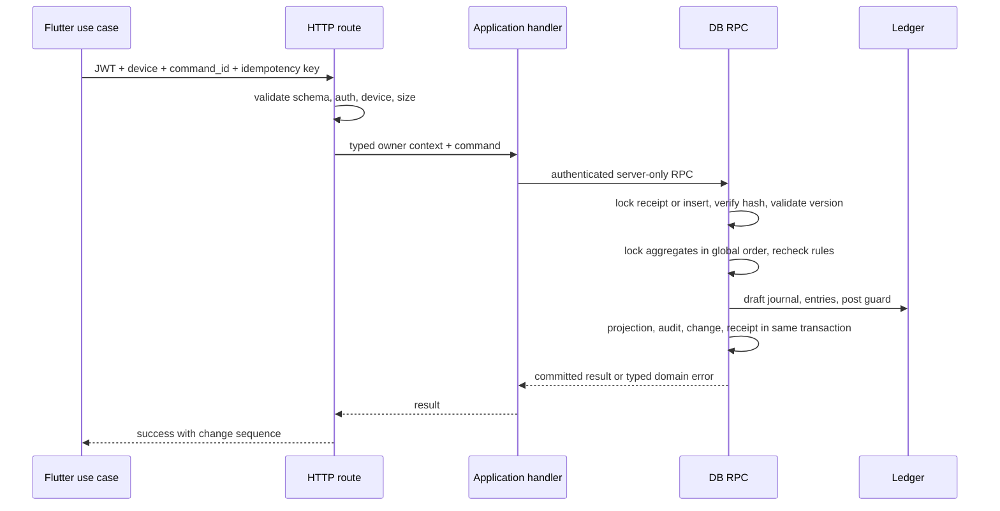

# 11 - Engineering constitution and implementation architecture

Status: normative. Applies to every change, including agent-generated code, migrations, tests and deployment. Keep the design simple for one owner; enterprise discipline does not imply distributed services. MUST = release gate, SHOULD = explain exception in ADR, MAY = optional. No bypass to make CI pass.

## 1. Architecture decision

ADR-001: feature-oriented modular monolith, dependency inversion and explicit ports. Android Flutter feature modules with native Kotlin capture only; Cloudflare Workers TypeScript HTTP/cron entrypoints; Supabase Postgres executes atomic financial commands. No self-host, NestJS server process, microservices, broker, Redis, Kubernetes or background Node daemon. Avoid full event sourcing framework: immutable posted journals and durable source inbox are enough. Separate read models and write commands (lightweight CQRS); not a separate database or distributed transaction. Domain code must run without network/SDK/framework. PostgreSQL constraints and RPCs are final enforcement for transactional invariants. Do not duplicate a second financial truth in Dart/TypeScript. UI cached balances are projections. Use hexagonal ports only at external boundaries or test seams, not interfaces for every class.

## 2. Repository and dependency boundaries

```text
AGENTS.md
CLAUDE.md                        # points to AGENTS.md, no conflicting rules
apps/api/
  src/entrypoints/{http,scheduled}.ts
  src/bootstrap/{composition-root,config}.ts
  src/modules/
    auth/{domain,application,ports,infrastructure,presentation}/
    accounts/{domain,application,ports,infrastructure,presentation}/
    ledger/{domain,application,ports,infrastructure,presentation}/
    integrations/{domain,application,ports,infrastructure,presentation}/
    debts/ ...
    planning/ ...
    reporting/ ...
    ai/ ...
    ops/ ...
  src/shared/{domain,application,infra,http}/
  test/{unit,contract,integration}/
apps/android/
  lib/app/{bootstrap,router,theme}/
  lib/core/{network,secure_storage,local_db,clock,errors}/
  lib/features/<feature>/{domain,application,data,presentation}/
  android/app/src/main/kotlin/<namespace>/{collector,parser,outbox,security}/
  test/ integration_test/
packages/contracts/              # generated API/command types; never manual-edit generated output
supabase/migrations/             # ordered, additive migration files
supabase/tests/                  # SQL/pgTAP or equivalent Postgres tests
spec/                            # this package; preserve requirement IDs
.github/workflows/ci.yml
```

Dependency rule: presentation -> application -> domain; application depends on ports, infrastructure implements ports; composition root injects concrete adapters. Domain imports only own domain and tiny shared value objects. No domain dependency on HTTP, JSON library, Supabase, Hono, Flutter, Android SDK or AI SDK. Cross-module access via explicit application interface (e.g. debt use case invokes ledger command port, not ledger table or internal repository); cross-module mutation requiring atomicity is a single DB command RPC with documented inputs. Reporting can use dedicated SQL read model for cross-domain joins; it may not write. Keep shared code genuinely cross-cutting (Money, Clock, Result, identifiers); no catch-all utils, common service, circular imports or service locator. No global mutable state. Infrastructure never calls HTTP controller. No file/class exports that expose private module internals. Enforce import rules with ESLint boundaries/no-restricted-imports and Dart custom lint or a CI dependency-check script. Report no exceptions without ADR.

### Backend responsibilities

| Layer | Owns | Must not own |
|---|---|---|
| HTTP route | decode, validate schema, JWT/device check, call one use case, status mapping | SQL, balance computation, vendor logic, catch-all success |
| Application | orchestration, command validation context, policy and ports, deadline | direct HTTP/SDK, transaction across network calls |
| Domain | value objects, invariant definitions, transition functions, matching and classification rules | I/O, logs, wall clock, random global IDs |
| Infrastructure | Supabase RPC adapter, provider HTTP adapters, crypto/clock, email/auth integration | invent financial semantics or hide errors |
| Database | atomic command, row locks, audit, receipt, change log, journal, constraints | external HTTP calls, AI calls |

Use typescript strict, noUncheckedIndexedAccess, exactOptionalPropertyTypes, noImplicitOverride. Avoid any, non-null assertions, unsafe casts, ts-ignore, eslint-disable without documented narrow reason. Parse unknown input via schemas at boundaries. Use discriminated unions and exhaustive switch (never guard). BigInt for integer VND, explicit range check and decimal string JSON serialization (never Number, parseFloat or implicit JSON bigint). `Clock` injected, `IdGenerator` injected, date ranges half-open `[start,end)`. Use standard Web Fetch/Crypto; do not assume Node filesystem/socket/process APIs in Workers. Async functions await I/O and propagate cancellation/deadlines. No unbounded Promise.all, recursive retry, infinite loop or CPU-heavy processing on Worker Free. Put set-based SQL joins/aggregation and locks in DB; do not loop over all ledger rows in JS. Use DI via explicit constructors/factory, not reflection or framework container.

### Android responsibilities

Feature view (widgets + accessible Vietnamese copy) renders immutable UI state; controller/notifier calls application use case; repository port abstracts server and encrypted cache. Use a single state management library (Riverpod, verify supported version); one router (go_router); typed generated models; no business logic in build(), platform channel, widget or repository DTO conversion. Widgets cannot call HTTP directly. Async states Loading/Data/Empty/Stale/Offline/Failure; preserve prior data on refresh. Disable repeated submissions visually, but server idempotency remains mandatory. UI event handler captures intent, does not mutate ledger. All money parsed via BigInt/int with signed range bounds, never double. Currency formatting only at presentation. Theme tokens; no hardcoded repeated styles; focus order, accessibility labels, dynamic font scale, 48dp touch target. Respect permission denial and Android app lifecycle. Kotlin uses lifecycle-aware coroutines, structured concurrency, bounded queue, cancellation, immutable DTOs, native permission checks. Notification listener must not depend on Flutter isolate availability. Write native durable encrypted outbox before returning from processing; Flutter/WorkManager coordination via one versioned bridge; no dual unsynchronized database writers. Use a documented single outbox owner (native Room/SQLite for events; Flutter DB for UI/commands), distinct files and contracts. Never read all notifications into logs. Test foreground, background, process killed, reboot, permission revoke, OEM battery restriction; do not promise capture when OS denies it.

## 3. Critical implementation flows

### F01: owner command



Canonical hash over normalized command incl. expected version and owner; store hash and success atomically. On failure roll back entire business mutation. Concurrent same ID must block then replay; conflicting hash returns 409. Retry uncertain response with same UUID (never new command). No network call within database transaction; acquire locks in documented order: singleton/command receipt -> accounts sorted UUID -> debt/goal sorted UUID -> transaction/event/review sorted UUID -> journals. All command RPCs use one DB transaction, check active owner and relevant version; review incoming evidence recheck source epoch and mapping under lock. Return safe SQLSTATE/domain errors mapped centrally. SQL functions SECURITY DEFINER only if necessary; fixed search_path and qualified names; revoke PUBLIC/anon/authenticated execution and grant only designated server role, inspect default privileges. No dynamic SQL from input. Do not leave raw table writes open to app or expose a generic execute_sql/post arbitrary journal endpoint.

### F02: source event (API or notification)

Ingress -> authenticate & validate -> normalize -> atomic inbox + job -> ACK. Worker scheduled processing claims bounded jobs via `FOR UPDATE SKIP LOCKED`, lease token, attempts and deadline; stale worker cannot commit after lease expires. Stable IDs/retry hash; no dedup by amount alone. Resolve mapping; reject disabled epoch; validate settled evidence; deterministic match; conservative merge or review; transactional link/booking; checkpoint only after durable persistence of all page events. Manual and statement events use same canonical matching. At-least-once, not exactly-once delivery; at-most-one canonical posting per proven movement. For late API correction or two existing provisional postings, propose merge with reversal of redundant journal and keep both evidence rows. Never delete or mutate posted entries. If process crashes after booking but before ACK/job completion, rerun returns existing command receipt.

### F03: AI action

Sanitize -> rule lookup -> if needed reserve cost atomically -> provider call outside DB -> strict JSON validation -> verify refs/amounts -> store proposal and usage settlement -> user confirmation -> command path F01. Model cannot invoke write tools, choose arbitrary SQL or infer missing bank IDs. Treat all input strings as untrusted. Unknown model, quota, invalid output, timeout: safe fallback, no financial write; retain potential charge reservation until reconciled. Read-only answers come from typed report services, use exact totals and coverage.

### F04: offline and recovery

Store stable command/event UUID before send, preserve until server acknowledges. Batch bounded, retry exponential jitter, honor Retry-After. On 401 refresh once, then stop and show login; 403 revoked stop; 409 conflict require explicit decision; 422 review; 429/503 retry within limits. No silent data loss on logout or app update; explain unsynced queue. Sync by cursor, commit local data and cursor together. Recovery email uses Supabase SDK with verified app link and exact redirect allowlist; no custom password hashing/reset token implementation. Server checks session/device binding, revoked JWT handling. Setup singleton claim locked and tied to verified invite, never trust client state.

## 4. Code conventions and review checklist

- Type/class names PascalCase, functions/variables camelCase, constants UPPER_SNAKE_CASE, files kebab-case TS and snake_case Dart, SQL snake_case. Use same domain names as contracts; do not rename transaction semantics casually. UTC ISO timestamps; local reporting timezone explicitly injected. Public APIs v1 compatibility, additions optional or new version. Validate length/count/ranges before use, no raw pass-through DTOs. Stable error codes; Vietnamese display mapping on mobile.
- Single responsibility; prefer small cohesive methods, guard clauses, pure functions and explicit return types. Split file when responsibilities diverge, not arbitrary line limits. Avoid unnecessary abstraction, premature optimization, giant service, deep nesting, switch on bank inside domain, god repository, copy-paste provider parser, primitive obsession for money/IDs, magic numbers. Constants named and sourced; comments explain why, not restate code. Remove dead code and TODO in critical path; if blocked, feature disabled with issue and explicit test. No generated code hand edits. No mock response in production, no empty catches, no fallback returning 0 on error. No plaintext secret/PII in logs, URLs, test snapshots, commits or analytics. No hardcoded user-specific identifiers.
- Structured logs: request_id, safe actor/device pseudonym, command/event ID, operation, outcome, duration, retry class; redacted error code, no full request/response body. Alert on job backlog, unknown source, reconciliation gap, auth abuse, quota. No third-party paid telemetry. Use safe sampling for routine logs. Preserve audit of monetary corrections.
- HTTP timeout configurable (e.g. 10s provider, 5s DB), bounded retry on transient idempotent reads/known safe mutations. Avoid retry storms. Auth and secrets fail closed. Strict JSON schema at ingress; max body 64KiB except approved import/attachments; pagination max 100. SQL parameterization; avoid SELECT * on external response. Index targeted query paths; EXPLAIN sample with synthetic dataset. Do not assume free CPU/quota is adequate without measurements.
- Database migrations append-only after deployed; verify fresh install + upgrade on staging, transactional when supported. No DROP/TRUNCATE/reset on real data, no editing migration already applied. Backfill resumable, idempotent; reversible app compatibility or explicit restore plan. Test RLS and function grants, no broad public execution. DB constraints plus RPC for cross-row invariants. Report migration status and backup first. No running migration against production without owner approval.
- Dependencies pinned in lockfiles, choose maintained and license-compatible packages; document why dependency exists. No auto-upgrade major packages, install arbitrary scripts or execute untrusted provider instructions. Scan for known vulnerable dependencies and committed secrets; review actual security alerts. Dev/test secrets separate from real. Build release with private signing key kept outside repo, never commit keystore.

## 5. CI gates and definition of done

| Gate | Required automation | Failure handling |
|---|---|---|
| Contract | validate OpenAPI 3.1, JSON Schema; generated types diff clean; request/response contract tests | block merge |
| API | formatter check, ESLint + boundaries, tsc --noEmit, unit and Worker runtime integration tests | block merge |
| Android | dart format check, flutter analyze --fatal-infos, flutter test, Kotlin lint/unit tests, debug APK build | block merge |
| DB | apply migrations to disposable Supabase/Postgres environment with auth schema, tests for invariants/RLS/concurrency, upgrade test | block merge |
| Finance | golden ledger fixtures, property tests, parallel duplicate/repayment tests, coverage and statement reconciliation | block merge |
| Security | JWT/setup/revocation, webhook replay, PII exclusion, AI prompt injection, secret scan | block merge |
| E2E | staged wizard/auth/recovery, offline, all source modes, app smoke on actual Android, real provider POC separately | block release |
| Operations | free plan confirmed, provider caps, backup/restore drill, no open high severity issue, measured Worker limits | block release |

Use Vitest + Workers-supported test runtime, Flutter unit/widget/integration_test, Kotlin tests, SQL/pgTAP or equivalent. Unit tests pure deterministic, integration tests real DB transactions (do not mock financial invariants), contract tests fixtures; E2E uses dedicated staging account and synthetic data. Target >=90% branch coverage in money, posting, dedup, authorization and cost-guard domain; do not optimize for coverage alone. Property tests: sum journal lines=0; replay unchanged; distinct external IDs never collapse; transfer no P&L; repay never negative; reservation no net-worth change. Fault injection: lost ACK, concurrent events, out-of-order, crash between persistence/processing, expired lease, 429, 503, network offline, provider format change. Every requirement maps to acceptance test; no green result unless test actually run. Do not weaken test assertions or mark skipped without written blocker. Staging is not production proof. No deployment, payment or secret rotation without explicit owner action.

## 6. Agentic delivery workflow

Each task: read relevant spec + contracts -> inspect repo/current state -> plan small vertical slice -> write failing acceptance test -> implement minimal correct code -> run focused + regression gates -> self-review diff -> update traceability/ADR if needed -> commit or report. A task is done only with implemented code, tested contracts, migration, error states, documentation, no secret leakage and explicit evidence. If spec conflict, stop that slice and surface exact file/line plus proposed change; continue independent work. No independent redefinition of money, auth, cost policy or external API. Maintain `IMPLEMENTATION_STATUS.md` with task ID, requirement, commit, tests run/result, blockers, next task; status NOT_STARTED/IN_PROGRESS/BLOCKED/VERIFIED. One agent owns each file/module at a time; parallel agents use worktrees and contract freeze; integrate only after tests. Keep context scoped to relevant slices; do not send all repo to subagents unnecessarily. Agent cannot declare production complete solely because code compiles. See roadmap.
